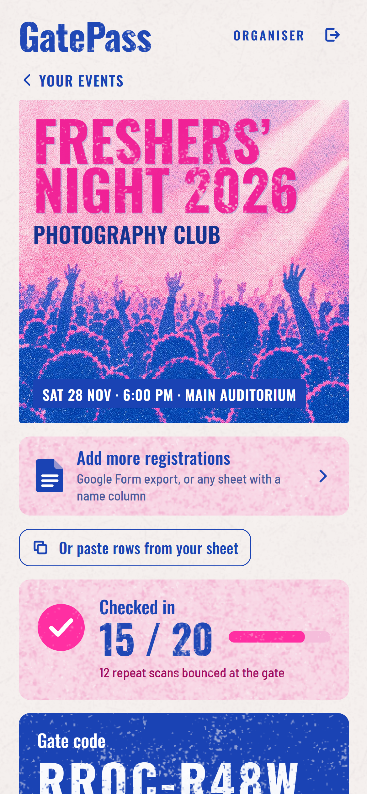
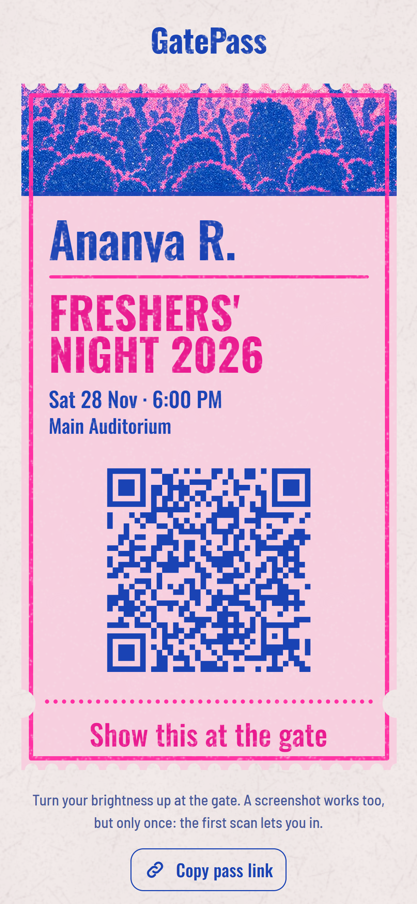
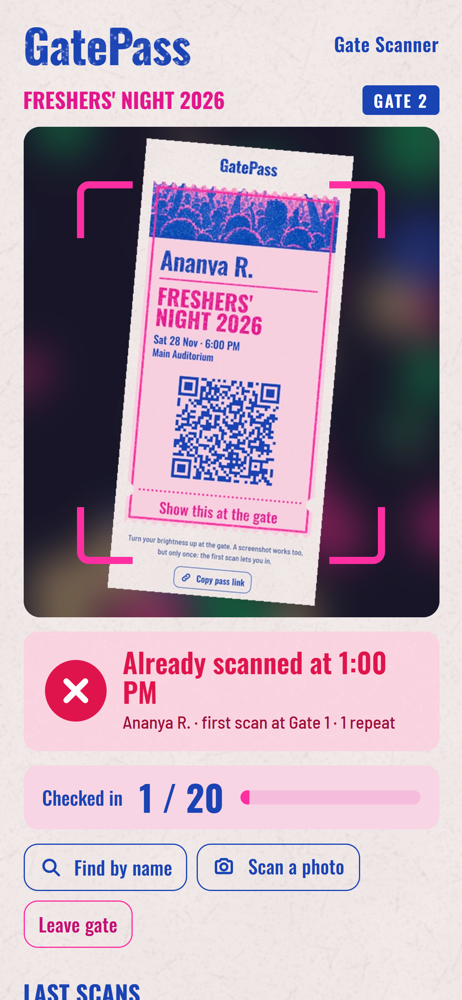

# GatePass

**Free QR entry passes for college club events.** Upload your registrations sheet and everyone gets their own pass. At the gate, any phone becomes the scanner. The first scan of a pass goes green; every scan after that goes red, on every phone at the gate, with the time and gate of the first scan. So a shared screenshot works once.

**Use it:** https://souradip121.github.io/gatepass/
**Or host your own copy for free** in five steps (below). No build step, no server, no paid plan.

<p>
  
  
  
</p>

Made by [@souradip.sh](https://www.instagram.com/souradip.sh/).

---

## How it works

| Who | What they do | Account? |
|---|---|---|
| **Organiser** | Signs in with an email link (or Google), creates the event, uploads the registrations CSV (or pastes rows from Google Sheets). Gets one pass per row and copies or exports every link to send on WhatsApp or email. Watches "Checked in N / total" live. | Yes |
| **Attendee** | Opens their link and shows the ticket at the gate. A screenshot works too, once. | No |
| **Gate staff** | Open `/gate/`, type the event's 8-character gate code, pick a gate name and point the camera at passes. "Find by name" covers dead phones. | No |

GatePass sends no email or messages itself. Each pass row has WhatsApp / email / copy buttons that open your own app with the message filled in.

### Why a screenshot only works once

Every pass has a 32-character random token (192 bits), so links can't be guessed. When a gate scans a pass, one database function does a single `INSERT … ON CONFLICT DO NOTHING` into `gp_scans`, guarded by a unique index that allows **one** accepted scan per pass (`gp_scans_first_once`). If two gates scan the same pass in the same millisecond, Postgres lets exactly one of them in; the other gets the first scan's time and gate back and shows red. Repeat attempts are logged, so the organiser sees "3 repeat scans bounced at the gate".

### Security model

- **Row Level Security** is on for every table. Organisers can only read and change their own events, passes and scans.
- **Attendees** read their pass through `gp_pass(token)`, which returns that one pass (name, event, check-in time) and never the contact details or anyone else's pass.
- **Gate staff** hold the event's gate code. Every staff action (`gp_gate_join`, `gp_scan`, `gp_gate_find`, `gp_gate_admit`, `gp_gate_stats`) is a `SECURITY DEFINER` function that checks the code first. The code has 31⁸ ≈ 850 billion combinations, and the organiser can replace it with one tap ("New code"); the old one stops working immediately. Staff search shows masked contacts only (`an•••@gmail.com`, `•••3210`).
- Only the **anon key** is in `config.js`. It's designed to be public; never put the `service_role` key in this repo.

---

## Host your own copy (free, 5 steps)

You need a free [Supabase](https://supabase.com) account and a GitHub account (or Netlify / Vercel).

1. **Create a Supabase project.** supabase.com → New project. Any region close to your college (Mumbai `ap-south-1` for most of India). Save the database password somewhere; GatePass never needs it.
2. **Run the schema.** In the project, open **SQL Editor → New query**, paste the whole of [`schema.sql`](schema.sql), and press **Run**. It creates three tables, their security rules and the scan functions, all prefixed `gp_`. It's safe to run again, and safe in a project that already has other tables.
3. **Put your keys in `config.js`.** Fork this repo, then edit [`config.js`](config.js): set `supabaseUrl` and `supabaseAnonKey` from **Project Settings → API** (Project URL, and the `anon` `public` key). If you haven't turned on Google sign-in in Supabase, set `googleSignIn: false`.
4. **Publish the site.**
   - **GitHub Pages:** in your fork, **Settings → Pages → Build and deployment → Deploy from a branch → `main` / `(root)`**. Your site appears at `https://<you>.github.io/gatepass/`.
   - **Netlify / Vercel:** import the repo. There is no build command; the publish directory is the repo root.
5. **Tell Supabase where the site lives.** **Authentication → URL Configuration**: set **Site URL** to your site's address and add it under **Redirect URLs** too (for example `https://<you>.github.io/gatepass/**`). Without this, sign-in links bounce to `localhost`. **Authentication → Providers → Email** must be enabled (it is by default).

Open your site, sign in, make an event, and do a test scan with two phones.

### Free-tier notes

- **Projects pause after about a week with no activity.** A paused project can't load passes or scan. Open your Supabase dashboard and press **Restore project** (takes a minute or two). Do a test scan the day before your event so nothing is asleep at the gate.
- **Sign-in emails:** Supabase's built-in mailer is for testing. It sends only a few emails per hour, and on newer projects only to members of your Supabase team. For more organisers, add custom SMTP (Authentication → Emails → SMTP; [Resend](https://resend.com) has a free tier) or turn on Google sign-in (Authentication → Providers → Google).
- **Size:** the free 500 MB database holds millions of passes; a fest of 5,000 people uses well under 5 MB.
- **Realtime:** the organiser's live counter uses Supabase Realtime (free tier: 200 concurrent connections). Gate phones poll every 5 seconds instead, so they never count against it.

---

## At the gate

- **Use Chrome or Safari**, not the Instagram/WhatsApp in-app browser: in-app browsers often block the camera. Allow camera access when asked.
- Each phone picks a **gate name** (Gate 1, Gate 2, Desk). Repeat scans show which gate let the pass in first.
- **Green** = let them in. **Red** = this pass was already used; the screen shows when and where. **Pink** = not a pass for this event.
- **Torch** and **switch camera** buttons appear on phones that support them.
- **Find by name** for a dead phone or cracked screen (check ID). **Scan a photo** if the live camera won't start.
- No signal? GatePass never admits offline; the verdict says "No connection" and nobody is marked in.

## What's stored

Event details, each attendee's name and the one contact column you choose (email or phone), and every scan (time, gate name, a random device id). Deleting an event deletes all of it. Attendees' pass pages show only their name, the event and whether the pass was used.

## Files

```
index.html          organiser app (sign-in, events, passes, gate code, live counter)
p/index.html        the attendee's pass, at p/#<token>
gate/index.html     the gate scanner
config.js           your Supabase URL + anon key (the only file you edit)
schema.sql          tables, RLS, scan functions (all gp_*)
assets/             css, js modules, fonts, poster art, textures
vendor/             supabase-js, jsQR, qrcode-generator (see vendor/LICENSES.md)
```

Plain HTML, CSS and JavaScript modules. No build step and nothing to install. To run it locally: `python -m http.server 8000` in the repo folder, then open http://localhost:8000 (add `http://localhost:8000/**` to Supabase's Redirect URLs).

## Licence

MIT. Fonts are SIL OFL; vendored libraries keep their own licences ([vendor/LICENSES.md](vendor/LICENSES.md)).
